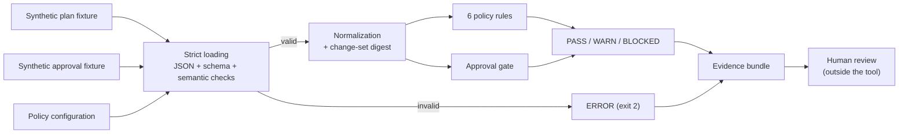

# iac-change-control-lab

> **LAB ONLY: synthetic, local fixtures.** This project evaluates *synthetic*, Terraform-plan-like
> JSON files against a small set of local policy rules and an approval gate, then writes a
> deterministic evidence bundle. It has no cloud access and no credentials, it never runs
> Terraform, and it never creates, modifies or destroys any infrastructure. A `PASS` is **not
> authorization** to change anything. Human review remains required.

## Purpose

This is a compact reference for **policy-as-code change review**. It shows how a proposed
infrastructure change can be:

1. strictly validated against a documented, deliberately limited input contract;
2. checked by independent, unit-tested rules (public ingress, wildcard IAM, storage encryption,
   destructive changes, required tags, Terraform/provider version metadata);
3. gated by an approval record bound to a **normalized change-set digest**;
4. reduced to one explicit decision (`PASS`, `WARN`, `BLOCKED`, `ERROR`) with fixed exit codes;
5. recorded as an inspectable, byte-reproducible evidence bundle with input provenance.

The design was written first as specs in
[`specs/2026-11-01-iac-change-control/`](specs/2026-11-01-iac-change-control/):
- [`plan.md`](specs/2026-11-01-iac-change-control/plan.md);
- [`requirements.md`](specs/2026-11-01-iac-change-control/requirements.md);
- [`validation.md`](specs/2026-11-01-iac-change-control/validation.md).

Every requirement ID maps to named tests, and a test enforces that mapping.

## Architecture



The tool stops at the evidence bundle. There is no code path to a cloud API, a Terraform binary
or any infrastructure.

| Path | Contents |
|---|---|
| `src/iac_change_control/` | Evaluator: strict loader, schema-subset validator, rules, approval gate, decision engine, evidence writer and verifier, CLI. Standard library only. |
| `schemas/` | JSON Schemas for the plan, approval, policy and evidence documents. The loader enforces the first three at runtime. |
| `policy/policy-config.json` | Default synthetic policy (`lab-baseline` 1.0.0). |
| `fixtures/` | 11 plan fixtures, 14 approval fixtures and 1 invalid policy. All synthetic. |
| `tests/` | Unit, integration, regression (goldens and byte stability), safety and traceability tests. |
| `scripts/` | `run_demo.py`, `run-evaluation.ps1`, and the optional `terraform-safe-check.ps1`. |
| `docs/` | [Fixture contract](docs/fixture-contract.md), [safe usage](docs/safe-usage.md), [future CI design](docs/ci-design.md). |
| `evidence/` | Generated bundles. Ignored by version control except its README. |

## Supported fixture contract (summary)

The full contract is in [`docs/fixture-contract.md`](docs/fixture-contract.md) and
[`schemas/synthetic-plan.schema.json`](schemas/synthetic-plan.schema.json).

- **Top level:**
  - `synthetic: true` and `contract_version: "iac-lab-plan/v1"`;
  - `fixture_id` and `description`;
  - `terraform_version` (`MAJOR.MINOR.PATCH`);
  - `change_context` (`LAB-CHG-NNNN`, `lab-*`);
  - `configuration.provider_config`;
  - `resource_changes[]`.
- **Providers:**
  - `name`;
  - `source`, which must be under the reserved `.example` domain;
  - optional `version_constraint`;
  - `selected_version`.
- **Resource changes:**
  - `address = <type>.<name>`, unique;
  - `provider_name`;
  - `change.actions`: one of `[no-op]`, `[create]`, `[update]`, `[delete]`, `[delete, create]` or
    `[create, delete]`;
  - `change.before`/`change.after`, consistent with the actions.
- **Five fictional types:**
  - `labcloud_firewall_rule`;
  - `labcloud_iam_policy`;
  - `labcloud_storage_bucket`;
  - `labcloud_database_instance`;
  - `labcloud_block_disk`.
- **CIDRs** must be canonical and either world (`0.0.0.0/0`, `::/0`) or inside private or
  documentation ranges.
- **Secrets:** credential-like keys and secret-like values are rejected.
- **Always `ERROR`, never compliant:**
  - malformed JSON;
  - duplicate keys;
  - unknown fields or actions;
  - unsupported types;
  - inconsistent changes;
  - an invalid policy.

## Rule catalog

| Rule | Title | Severity | Blocking |
|---|---|---|---|
| `IAC-NET-001` | Sensitive or all ports open to the world | critical | blocking |
| `IAC-NET-002` | Non-allowlisted port open to the world | medium | non-blocking |
| `IAC-IAM-001` | Wildcard IAM action or resource | critical | blocking |
| `IAC-IAM-002` | Service-scoped IAM action wildcard | medium | non-blocking |
| `IAC-ENC-001` | Storage encryption missing or disallowed | high | blocking |
| `IAC-CHG-001` | Destructive change proposed | high | non-blocking (requires elevated approval) |
| `IAC-TAG-001` | Required tags missing or blank | high | blocking |
| `IAC-VER-001` | Terraform version outside supported range | high | blocking |
| `IAC-VER-002` | Provider not allowlisted | high | blocking |
| `IAC-VER-003` | Provider version outside allowed range | high | blocking |
| `IAC-VER-004` | Provider version constraint missing | high | blocking |
| `IAC-APR-001` | Approval missing | high | blocking |
| `IAC-APR-002` | Approval rejected | high | blocking |
| `IAC-APR-003` | Approval stale (policy version changed) | high | blocking |
| `IAC-APR-004` | Approval out of scope | high | blocking |
| `IAC-APR-005` | Approval digest mismatch | high | blocking |
| `IAC-APR-006` | Elevated approval required for destructive change | high | blocking |
| `IAC-APR-007` | Approved destructive addresses do not match | high | blocking |

Every finding carries:
- `rule_id`, `title`, `severity`, `blocking`, `requires_elevated_approval`;
- a synthetic `address`;
- `detail_key`, `reason`, `remediation`.

Findings are sorted by `(rule_id, address, detail_key)`. IAM parsing is deliberately simplified:
only `Allow` statements are checked, for exact `"*"` and `service:*` actions. There are no
conditions, and partial resource wildcards are not evaluated.

## Decisions and exit codes

| Decision | Meaning | Exit |
|---|---|---|
| `PASS` | No findings, and the approval gate is valid. | 0 |
| `WARN` | Only non-blocking findings, and the approval gate is valid. A human must accept the warnings. | 0 |
| `BLOCKED` | A blocking policy finding, or the approval gate failed. | 1 |
| `ERROR` | Invalid input, configuration or evaluator state. No policy decision was made. | 2 |

`ERROR` never passes. An unexpected exception inside the evaluator also becomes `ERROR`.

## Approval digest and gate

The change-set digest is `sha256:` followed by the SHA-256 of compact canonical JSON over the
normalized plan:
- Terraform version;
- change context;
- provider metadata;
- resource changes sorted by address.

Key order, resource order, whitespace, `fixture_id` and `description` do not change the digest.
Any substantive change does. Print it with:

```powershell
python -m iac_change_control.cli digest --plan fixtures/plans/compliant.json
```

The gate runs seven checks in order:

1. present;
2. approved (not rejected);
3. policy version current (not stale);
4. scope matches;
5. digest matches;
6. elevated approval when the plan has any delete;
7. the approved destructive addresses equal the plan's destructive addresses.

Every failure is a blocking finding. **A valid approval never suppresses a blocking policy
finding.** There is no exception mechanism. A destructive change becomes `WARN` (not `PASS`) only
with an elevated approval that lists every destructive address.

## Evidence bundle and reproducibility

Each run writes five files to the `--output` directory. `ERROR` runs also get a bundle.

| File | Contents |
|---|---|
| `evaluation.json` | Decision, exit code, decision basis, digest, sorted findings, counts, gate result, errors, notice, non-claims. |
| `summary.md` | Human-readable rendering with a synthetic/local banner and a human-review footer. |
| `provenance.json` | Basename, SHA-256 and size of each input; plan fixture ID; approval ID; policy ID and version; evaluator version; run ID; decision. |
| `approval-assessment.json` | Every gate check (`pass`, `fail` or `not_evaluated`), with expected and presented values. |
| `manifest.sha256` | `sha256sum`-format hashes of the four files above, sorted. |

**Guarantees:**
- Evidence is canonical JSON (sorted keys, LF, UTF-8).
- There are no timestamps, random IDs, absolute paths or host data.
- The run ID is caller-supplied.
- The same inputs and run ID give byte-identical bundles. Tests check this across
  `PYTHONHASHSEED` values, working directories, relative and absolute paths, and golden files.
- `verify-bundle` re-checks a bundle against its manifest.

## Quick start (Windows PowerShell)

Requirements: Python ≥ 3.11 (built with 3.13.7). Terraform and Docker are **not** required.

```powershell
cd iac-change-control-lab
python -m venv .venv
.\.venv\Scripts\Activate.ps1
python -m pip install -r requirements-dev.lock
python -m pip install --no-deps --no-build-isolation -e .

# Evaluate the compliant fixture (PASS, exit 0)
python -m iac_change_control.cli evaluate `
  --plan fixtures/plans/compliant.json `
  --approval fixtures/approvals/approved-change.json `
  --policy policy/policy-config.json `
  --output evidence/run-compliant `
  --run-id fixture-compliant-v1
$LASTEXITCODE

# A blocked change (exit 1) and an invalid input (exit 2)
python -m iac_change_control.cli evaluate --plan fixtures/plans/public-ingress.json `
  --approval fixtures/approvals/approved-public-ingress.json --policy policy/policy-config.json `
  --output evidence/run-public-ingress --run-id fixture-public-ingress-v1
python -m iac_change_control.cli evaluate --plan fixtures/plans/malformed.json `
  --policy policy/policy-config.json --output evidence/run-malformed --run-id fixture-malformed-v1

# Verify a bundle against its manifest
python -m iac_change_control.cli verify-bundle --bundle evidence/run-compliant
```

`scripts/run-evaluation.ps1 -Plan <file> [-Approval <file>] -RunId <id>` wraps the same command.

## Tests and demo

```powershell
python -m pytest -q          # unit, integration, regression, safety, traceability
python -m ruff check .
python scripts/run_demo.py   # 9 cases: PASS, WARN, BLOCKED and ERROR, all bundles verified
```

The demo writes only to `evidence/demo/` (ignored) and labels every row `[synthetic/local]`.
The optional `scripts/terraform-safe-check.ps1` does the following:
- runs only `terraform version` and `terraform fmt -check`;
- uses a pinned Docker image with no container network;
- targets a provider-free, resource-free sample;
- is skipped cleanly when Docker is unavailable.

## What this lab does not do

- It has **no cloud access**. It never contacts a cloud account, cloud API, remote backend or
  remote state, and never uses provider credentials or `.env` files.
- It never reads **real Terraform plans or state**. Every fixture is synthetic, with fictional
  resource types, reserved CIDR ranges and `.example` provider sources.
- It never runs **Terraform `init`, plan, apply, destroy, import or refresh**, and never downloads
  a provider.
- A `PASS` or `WARN` is **not authorization** to change infrastructure.
- It is not a **complete policy evaluation**, and not a replacement for a policy engine.
- It is not a **production control plane**.
- It is not a **compliance** control, audit result or certification.

The evidence non-claims, repeated verbatim:

- Inputs are synthetic fixtures, not real Terraform plans, state, or cloud resources.
- No cloud account, credential, remote state, or provider was accessed.
- Terraform was not executed: no init, plan, apply, destroy, import, or refresh occurred.
- The rule set is illustrative and incomplete; it is not a policy engine replacement.
- This is not a compliance control, audit result, or certification.
- A PASS or WARN is not authorization to change infrastructure; human review is required.

## Portfolio positioning

This lab shows how I approach infrastructure change control as testable engineering:
- explicit input contracts that fail closed;
- small, independently tested rules;
- approval records bound to exactly what was reviewed;
- evidence that a reviewer can re-verify byte for byte.

Its scope is limited to local policy and evidence controls over synthetic fixtures. It makes no
claim about operating real cloud environments.

## License

No license has been selected yet. That is the owner's decision.
