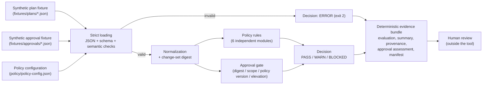

# Plan: `iac-change-control-lab`

- **Spec date:** 2026-11-01
- **Status:** approved for local build (Priority D, optional portfolio item)
- **Companion specs:** [`requirements.md`](requirements.md) (requirement IDs) and
  [`validation.md`](validation.md) (commands, expected results, traceability matrix)

## 1. Purpose

Build a compact, local, fixture-driven reference lab that demonstrates **policy-as-code review
of a proposed infrastructure change before a hypothetical deployment**:

1. strict validation of a small, documented, synthetic, Terraform-plan-like JSON contract;
2. independent, unit-testable policy rules (public ingress, wildcard IAM, storage encryption,
   destructive changes, required tags, Terraform/provider version metadata);
3. an approval gate bound to a normalized change-set digest;
4. one explicit decision per run (`PASS`, `WARN`, `BLOCKED`, `ERROR`) with fixed exit codes;
5. a deterministic, inspectable evidence bundle with input provenance and hashes.

The tool **never applies, plans, imports or destroys infrastructure**. It reads checked-in
synthetic JSON files and writes local evidence files. A `PASS` is not authorization to change
anything: **human review remains required, outside the tool.**

## 2. Scope

**In scope**

- An offline Python CLI (`python -m iac_change_control.cli`), with a standard-library-only
  runtime.
- A limited plan contract (`iac-lab-plan/v1`) using only these Terraform concepts:
  - `terraform_version`;
  - `configuration.provider_config` metadata;
  - `resource_changes[]`, each with `address`, `type`, `name`, `provider_name` and
    `change.actions`/`before`/`after`.
- Five fictional resource types under a fictional provider, `labcloud`:
  - `labcloud_firewall_rule`;
  - `labcloud_iam_policy`;
  - `labcloud_storage_bucket`;
  - `labcloud_database_instance`;
  - `labcloud_block_disk`.
- An approval contract (`iac-lab-approval/v1`) and a policy configuration contract
  (`iac-lab-policy/v1`).
- JSON Schema documents for every contract, including the evidence output. The runtime enforces
  them with a small stdlib JSON Schema subset validator.
- Evidence bundles, a bundle verifier, a digest helper command and a terminal demo.
- Local tests (unit, integration, regression, safety, traceability), ruff, and an optional,
  non-blocking Terraform-safe check through Docker.

**Non-goals**

- Real Terraform plan JSON, real provider schemas, or real resource types, account IDs,
  hostnames, IP addresses or state.
- Any cloud API, provider SDK, remote backend, credential, or Terraform `init`/plan/apply/
  destroy/import/refresh/state command.
- A complete policy language (IAM parsing is deliberately simplified), a replacement for a
  policy engine, a production control plane, or compliance certification.
- Git history, GitHub, CI workflow files, a license, packaging, releases or deployment. These
  are owner decisions for later phases.

## 3. Architecture



The tool stops at the evidence bundle. It has no code path that contacts a cloud provider,
runs Terraform, or changes infrastructure.

### 3.1 Modules (`src/iac_change_control/`)

| Module | Responsibility |
|---|---|
| `canonical.py` | Canonical JSON bytes (sorted keys, indent 2, LF, UTF-8, trailing newline), compact digest bytes, SHA-256 helpers. |
| `schema_validator.py` | A small, strict subset of JSON Schema 2020-12. Unknown keywords are a schema-authoring error. Messages never echo input values. |
| `models.py` | Frozen dataclasses (`Plan`, `ResourceChange`, `Policy`, `Approval`, `Finding`, `InputError`), constants, the rule catalog, decision and exit-code constants, the notice and non-claims. |
| `plan_loader.py` | Strict JSON reading. Plan, approval and policy loaders: schema validation, then semantic checks (addresses, actions, before/after consistency, reserved CIDRs, provider references, credential-like keys and secret-like values), then normalization and the change-set digest. |
| `rules/*.py` | One module per control. Each exposes `evaluate(plan, policy) -> list[Finding]`. `approval_gate.py` exposes `assess(...)`. |
| `policy_engine.py` | Orchestration: load, run rules, run the gate, sort findings, decide. Any unexpected exception becomes `ERROR`. |
| `evidence.py` | Writes and verifies the five-file evidence bundle. |
| `cli.py` | `evaluate`, `digest` and `verify-bundle` subcommands with fixed exit codes. |

### 3.2 Decision model

| Decision | Condition | Exit |
|---|---|---|
| `ERROR` | Any input, schema, semantic, policy-config or evaluator error. Rules are not trusted after an error. | 2 |
| `BLOCKED` | At least one blocking policy finding, or the approval gate failed. | 1 |
| `WARN` | No blocking finding, approval gate valid, at least one non-blocking finding. | 0 |
| `PASS` | No findings, approval gate valid. | 0 |

There is no hard-violation exception: a valid approval never suppresses a blocking policy
finding. A destructive change (`IAC-CHG-001`) is non-blocking only when an **elevated** approval
explicitly lists every destructive address. Otherwise the gate blocks.

## 4. Policy and evidence workflow

1. **Load** the plan, the approval (optional on the command line; a missing approval blocks) and
   the policy. Reading is strict: UTF-8, at most 1 MiB, no duplicate keys, no NaN or Infinity,
   top-level object.
2. **Validate** each document against its schema in `schemas/`, then run the semantic checks.
   Any failure collects sorted errors and yields `ERROR`.
3. **Normalize** the plan and compute
   `change_set_digest = "sha256:" + SHA-256(compact canonical JSON)` over:
   - the Terraform version;
   - the change context;
   - provider metadata;
   - resource changes sorted by address.

   Descriptive fields (`fixture_id`, `description`), key order, resource order and whitespace do
   not affect the digest. Any substantive change does.
4. **Evaluate** the six policy rules, then the approval gate (checks `IAC-APR-001`..`007`).
5. **Sort** findings by `(rule_id, address, detail_key)` and decide.
6. **Write** the evidence bundle to the caller's `--output` directory:
   - `evaluation.json`;
   - `summary.md`;
   - `provenance.json`;
   - `approval-assessment.json`;
   - `manifest.sha256`.

   Evidence carries no timestamps, random IDs, absolute paths, hostnames or usernames. Inputs are
   identified by basename, SHA-256 and size.
7. **Human review** of the bundle happens outside the tool.

## 5. Synthetic fixture design

- Every plan, approval and policy file carries `"synthetic": true` and a `contract_version`.
- **Identifiers are fictional by construction:**
  - provider `labcloud`, with source `registry.example/synthetic/labcloud`. The reserved
    `.example` TLD is mandatory.
  - change references use the form `LAB-CHG-NNNN`, and environments use the form `lab-*`.
  - approvers are recorded by role only (`approver_role`), never by name.
- **Network values** must be canonical CIDRs inside reserved ranges:
  - world `0.0.0.0/0` and `::/0`;
  - RFC 1918 private ranges and IPv6 `fd00::/8`;
  - documentation ranges: RFC 5737 (`192.0.2.0/24`, `198.51.100.0/24`, `203.0.113.0/24`) and
    RFC 3849 (`2001:db8::/32`).

  Anything else is `ERROR`.
- Credential-like keys (password, secret, token, API key, access key, private key, credential)
  and secret-like values (for example key-ID or PEM-header shapes) are rejected as `ERROR`.
- **One plan fixture per outcome:**
  - `compliant`;
  - `warn-nonstandard-port`;
  - `public-ingress`;
  - `wildcard-iam`;
  - `unencrypted-storage`;
  - `destroy-change`;
  - `missing-tags`;
  - `provider-version-violation`;
  - `mixed-violations`;
  - `malformed`;
  - `unsupported-resource`.
- **Approval fixtures:**
  - `approved-change`;
  - `approved-warn-change`;
  - `approved-destroy-standard`;
  - `approved-destroy-elevated`;
  - `missing-approval`;
  - `rejected-approval`;
  - `stale-or-out-of-scope-approval`;
  - `digest-mismatch-approval`.
- **One invalid policy fixture.**
- Approval fixtures pin the digest of their target plan. Tests that need a matching approval for
  a violating plan generate one in a temporary directory, to prove that approvals never suppress
  hard violations.

## 6. Safety boundaries

- **No network:**
  - Static checks forbid network, cloud, provider-SDK, Terraform-wrapper and HTTP imports in
    the source and scripts.
  - An autouse test fixture blocks socket connections during the whole test run.
- **No process execution and no environment reads** in the evaluator source, so there are no
  credential environment variables and no hidden Terraform calls. The evaluator also runs with
  an empty `PATH`.
- **No state-changing Terraform command anywhere executable.** The optional check script can run
  only `version` and `fmt -check`, in a network-disabled container, against a provider-free,
  resource-free sample module.
- **No Git, GitHub, CI or publication operation** in code or scripts. In this build phase there
  is no `.git`, no `.github/workflows` and no license. That is a recorded build-phase validation
  step, not a permanent test.
- Generated evidence lives only under `evidence/`, which `.gitignore` excludes (except
  `evidence/README.md`).

## 7. Project structure

```text
iac-change-control-lab/
  README.md, BUILD_REPORT.md, pyproject.toml, requirements-dev.lock, .gitignore, .gitattributes
  specs/2026-11-01-iac-change-control/{plan,requirements,validation}.md
  src/iac_change_control/
    __init__.py, __main__.py, cli.py, canonical.py, schema_validator.py, models.py,
    plan_loader.py, policy_engine.py, evidence.py
    rules/{__init__,public_ingress,wildcard_iam,storage_encryption,destroy_changes,
           required_tags,provider_version,approval_gate}.py
  policy/policy-config.json
  schemas/{synthetic-plan,approval,policy-config,evidence}.schema.json
  fixtures/plans/*.json, fixtures/approvals/*.json, fixtures/policies/invalid-policy.json
  terraform-sample/main.tf          (provider-free, resource-free; for the optional fmt check)
  tests/helpers.py, tests/conftest.py
  tests/unit/, tests/integration/, tests/regression/ (golden outcomes and evaluation files)
  tests/test_traceability.py, tests/test_safety.py
  scripts/run_demo.py, scripts/run-evaluation.ps1, scripts/terraform-safe-check.ps1
  docs/{fixture-contract,safe-usage,ci-design}.md
  evidence/README.md                (all other evidence output is ignored)
```

The additions beyond the requested tree are modest:
- `canonical.py` and `schema_validator.py` (shared helpers);
- `policy-config.schema.json`;
- `fixtures/policies/` (an invalid policy for `ERROR` tests);
- `terraform-sample/` (the target for the optional fmt check);
- `scripts/run_demo.py` (the required demo command);
- `.gitattributes` (pins LF so fixture hashes are stable across checkouts).

## 8. Implementation order

1. Specs (this file, `requirements.md`, `validation.md`).
2. Tooling: `pyproject.toml`, local `.venv`, pinned `pytest` and `ruff`, `.gitignore`.
3. `canonical.py`, `schema_validator.py`, `models.py`, schemas, policy config.
4. `plan_loader.py` (strict reading, schema, semantics, digest).
5. Rule modules, then the approval gate.
6. `policy_engine.py`, `evidence.py`, `cli.py`.
7. Fixtures: plans, then digests, then approvals that pin those digests.
8. Tests (unit, integration, regression goldens, safety, traceability).
9. Scripts, the demo, the optional Terraform-safe check, docs, README.
10. Full validation (`validation.md` §2), then `BUILD_REPORT.md`.

## 9. Deterministic artifact strategy

- **Canonical JSON** for evidence: `json.dumps(sort_keys=True, indent=2, ensure_ascii=False)`,
  plus `"\n"`, UTF-8, written in binary mode (LF on every OS).
- **Digest bytes:** compact canonical JSON (`separators=(",", ":")`) with the domain tag
  `iac-lab-changeset/v1`.
- **No variable inputs to evidence:** no timestamps, no random values, the run ID supplied by
  the caller (validated pattern), basenames only, and no interpreter version or host data.
- **Stable sort order** for findings, checks, errors, resources and manifest lines.
- **Proof:**
  - repeated runs are compared byte for byte, across `PYTHONHASHSEED` values and working
    directories;
  - golden `evaluation.json` files and golden outcome and digest tables live in
    `tests/regression/`.

## 10. Optional Terraform-safe check

`scripts/terraform-safe-check.ps1` is optional and never blocks the core evaluator or tests.
- **If Docker is available**, it runs the pinned image `hashicorp/terraform:1.14.0` (an explicit
  `MAJOR.MINOR.PATCH` tag; `latest` is rejected) with:
  - `--network none` and `CHECKPOINT_DISABLE=1`;
  - only `terraform-sample/` mounted, read-only.

  It runs only `version` and `fmt -check -recursive`.
- **If Docker or the image is unavailable**, it prints `SKIP` with a reason and exits 0.

It never runs `init` or any planning, apply, destroy, import, refresh or state command, and it
never downloads a provider. The sample declares none.

## 11. Requirement-to-test mapping approach

- `requirements.md` defines stable IDs: `REQ-*` (functional), `NFR-*` (non-functional) and
  `SAFE-*` (safety).
- `validation.md` §3 maps every ID to:
  - named test functions;
  - an implementation location;
  - an expected evidence artifact.
- `tests/test_traceability.py` fails if:
  - an ID lacks a row;
  - a row names a missing test function or implementation path;
  - a row lacks evidence;
  - the matrix references an undefined ID.

  A negative self-test proves the checker rejects an unmapped requirement.
